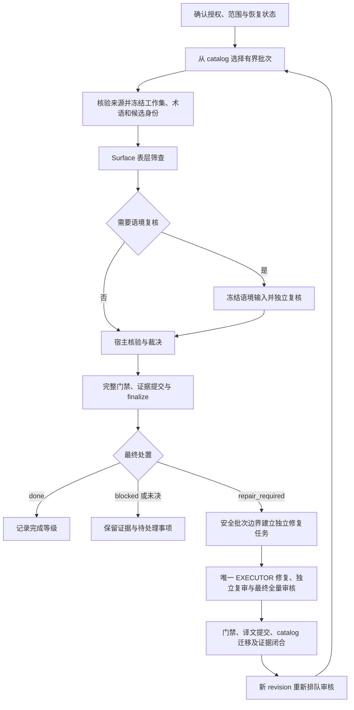

# ToME4 中文翻译项目：AI 校对工作流程与经验教训技术报告

日期：2026-09-30。资料基线：仓库提交 `9643e84c07fce3641599a1d88059d092c1734bd9`。

本文面向翻译项目维护者与 AI 工具链开发者，总结本项目已经执行的流程、实验与事故。依据为受跟踪的规则、契约、工具实现、实验报告和批次证据；未重新运行模型实验、生产审核或游戏运行测试，也未把工作区中未提交的研究材料纳入结论。文中的历史统计均注明对应时间或样本，不代表新的全库测量。

**摘要。** 本项目将 AI 用于发现翻译疑点、提出修订和独立复核，通过固定源码、运行时上下文、版本化术语与确定性检查裁决这些输出。实践表明，多模型可以增加问题覆盖，但也存在共同漏检、逐词误报、上下文诱导和反复改写；审核输出合法、技术门禁通过与译文语义正确是不同层面的保证。有效的工作单元是绑定具体译文版本的有界批次：冻结输入，隔离实现与复审，逐项核验证据，集中修复，保存原始输出，完成可重放的验收。流程的主要成本还包括源码取证、误报裁决、子代理管理和证据重放，不能只用模型响应速度衡量效率。

## 1. 项目对象与证据边界

项目维护 ToME4 的规范中文 Lua 译文、术语库，以及提取、审核、构建和发布工具。文本包括技能机制、装备说明、界面标签、运行日志、对话和长篇叙事。同一句英文可能在多个组件出现；一个显示句也可能由格式参数、辅助函数和条件分支共同组成。校对因此需要同时检查自然语言与程序消费方式。

本体目标为 ToME4 1.7.6，manifest 固定 engine commit 为 `624a67329fe2ad440c5b344785a9c73fcf22ae63`，并单独固定提取器。三个官方 DLC 源码公开，但当前 manifest 只固定提取快照哈希及条目数，未固定 DLC 源码仓库、commit 或发行版本。公开性、可访问性与版本固定程度必须分别记录，不能把提取快照称为 DLC 1.7.4 源码证明。[版本清单](../i18n/versions/tome-1.7.6.json)、[工具说明](../i18n/README.md)

按 2026-09-29 第 372 批闭合后的交接记录，正式队列状态如下；本报告未重新构建该队列。

| 指标 | 记录值 | 正确解释 |
| --- | ---: | --- |
| 当前 eligible 条目 | 29,828 | 当前 catalog／policy 的审核集合，不能代替整个仓库条目数 |
| surface 覆盖 | 29,828 | 表层阶段覆盖记录 |
| `done` | 29,812 | 满足各自完成等级的流程条件 |
| 其中 `surface_only` | 28,718 | 仅表层筛查完成 |
| 其中 `deep_reviewed` | 1,094 | 已完成适用语境审核及裁决 |
| `blocked` | 16 | 含死键／冻结未匹配、工具收口路径缺口和待落实改名 |
| 批次／修复窗口 | 372／56 | 已闭合的批次及窗口编号，不是独立抽样次数 |

这组记录说明了生产覆盖规模，不能推出“29,812 条全部正确”或“全库已经深审”。交接还记录窗口 57 有 3 条积压，而队列 `pending_repair=0`：宿主维护清单与队列状态的计数对象不同，汇报时应同时说明。生产当时已按用户要求暂停；本文写作不恢复该任务。[当前交接](../handoff.md)

## 2. 流程演进与职责分离

早期工作先建立 Lua 加载、占位符、运行键和术语等确定性基础，再开展有界译文修订、质量评估实验及组件扩展。历史 P1 记录了 190 条互不重叠 revision、64 个已处理 finding；后续 P2 扩展到 DLC、核心叙事和运行时机制。正式生产随后采用 WP2-Lite，把 catalog、审核队列、批次证据和修复边界连接起来。早期 pi 路由资产已归档，历史质量方案、Facts 实验和旧 contextual v1 的结论须按各自版本理解，不能直接充当现行操作模板。[历史路线图](project-roadmap.md)、[文档状态索引](README.md)

正式编排采用以下分工。

| 角色 | 主要工作 | 边界 |
| --- | --- | --- |
| ORCHESTRATOR | 定义范围、冻结候选、核验源码、裁决观察、验证和交付 | 写编排记录与验证产物；不代替 EXECUTOR 修改任务内容 |
| EXECUTOR | 根据已授权 SPEC 修改译文、术语或工具 | 唯一任务内容写入者；按允许文件和验收清单执行 |
| REVIEWER | 独立审核冻结译文或实现候选 | 只读；返回观察或 finding，不能直接修复 |
| SENIOR_REVIEWER | 范围校准、高影响流程交叉复审 | 只读；防止复审不断扩大工程范围 |
| SCOUT | 查询相关源码并压缩上下文 | 返回证据上下文，不替代审核或最终裁决 |

“宿主裁决”在很多记录中仍由主 AI 代理完成，不天然等于人类判断。维护者负责授权、偏好和争议边界定标；宿主必须提供可复查证据，而不能以模型数量或自报 severity 代替事实。普通只读检查和小型文档维护可由主代理直接完成，不自动启动上述编排。[代理规则](../AGENTS.md)、[编排契约](paseo-orchestration-v2-contract.md)

模型配置属于运行记录。2026-09-29 的生产安排使用 GPT-6 Sol 作 surface、Claude Opus 5.5 作 contextual、GPT-5.6 Sol 作修复执行；这些是当时的配置，不能固化为角色定义或据名称推定质量。尤其应区分：**surface 的四路通常是互不重叠的分片，不是每条译文被四个模型重复审查。** contextual v2 的四成员 stage 同样可用于分片覆盖，其最终整批复审才负责跨片一致性。[操作指南](review-operations-guide.md)、[contextual v2 契约](paseo-translation-context-review-v2-contract.md)

## 3. 现行生产流程

### 3.1 选集、冻结与预检

任务先区分只读审查、实现和正式生产批次，检查工作树及活动 checkpoint。正式批次从版本化 catalog 领取，通常最多 80 条；混合组件或短尾批次按适用来源和契约拆分，不能假定每路固定 20 条。每个批次明确允许文件、revision 集合、来源和完成条件，并保留 SPEC、PLAN、SCOPE、STATE。

冻结的作用是让“审核对象”成为可验证的数据：原文、译文、`source_tag`、`args_order`、来源身份、实际术语正文和有界上下文都应完整对应。哈希只能证明字节相同，不能证明内容充分。只有术语文件路径或摘要，没有术语行正文，不足以给 reviewer 提供术语依据。

源码核验发生在派发之前，语境输入执行 anchor preflight。无法匹配的条目应先区分上游改串后的死键、动态拼接和真正缺失，不用全库字符串回退掩盖来源错误。DLC 文件可以用本批 SHA-256 绑定取证内容，但仍须保留来源未固定的说明。[工作流](agent-workflow.md)、[操作指南](review-operations-guide.md)

### 3.2 表层筛查与语境审核

Surface 检查明显错译、占位符、标记、参数顺序和格式问题。它只能读取冻结输入及明确允许的引用，不能自行扩展源码调查；输出为逐条 `OK` 或 `ISSUE`。`ISSUE` 是候选信号，`OK` 只表示此次表层筛查未命中。

当前生产操作将 surface 标出的条目送入 contextual 复核。Contextual 可沿调用链查询输入指定位置中的相关冻结版本源码，检查机制、对象、关系和术语适用性。两阶段都不能读取其他 reviewer 的结果、旧 finding 或当前可变译文来补齐判断。这种隔离减少意见传染，也要求宿主先提供足够的中性材料。

结果校验逐位置核对完整条目集合和候选 identity，拒绝缺项、串项、多余字段与不合契约的输出；精确原始字节保存后再解析。不同契约的字节要求并不完全相同：surface 要求 canonical compact JSON，contextual 也严格限制结构和前后附加内容。不能将某次研究允许的输出规范化直接套用到生产审核。[surface 契约](paseo-translation-surface-screen-v1-contract.md)、[contextual v2 契约](paseo-translation-context-review-v2-contract.md)

### 3.3 宿主裁决

每项观察都要独立核验，给出具体意义变化、证据和最强反证。

| 处置 | 判定依据 | 后续动作 |
| --- | --- | --- |
| `confirmed` | 源码或完整语境支持存在缺陷 | 在既有授权内进入修复 |
| `refuted` | 观察不成立，有反证 | 保留撤销理由 |
| `advisory` | 表达可改进，但不能证明失义或损坏 | 通常不阻断完成 |
| `pending` | 证据缺失、源文歧义或需要维护者策略 | 保留待决，不自动修复 |

证据状态与修复优先级分开判断。叙事细节即使影响较低，也可能有可确认的意义偏差；机制风险即使很大，没有证据仍只能待确认。发现逐词差异后，还要检查完整句段是否已表达该限定、代词是否承接前文、调用参数是否支持现译，以及英文自身是否与实现冲突。名称选择中的用户授权裁决路径只适用于该范围，不能推广为用多数票裁定机制。[工作流判定规则](agent-workflow.md)、[操作指南裁决表](review-operations-guide.md)

### 3.4 审核与修复分离

活动审核批次内不修改译文；审核证据提交并 finalize、checkpoint 移除后，才能另建修复任务。当前交接采用已确认可执行项累计到 20 条的合并窗口，高影响缺陷及停止条件仍服从上位规则。历史“三批窗口”等节奏不能覆盖会话中更新的有界授权。

修复前对各来源批次执行 preflight，保留各自 provenance，按 revision 去重，并检查跨组件同一运行键的兄弟条目。同一轮全部 accepted finding 集中交给一次 EXECUTOR dispatch。修复后重新冻结候选，独立复审；v2 implement 必须以成功的 whole-workset `FINAL_REVIEW/full` 收束，分片 stage 本身不能关闭任务。

复审需要可收敛的标准。旧 v1 对忠实度、完整性、术语、运行行为及格式不变量持续允许 reopen，对纯语感问题设置较短窗口，纯偏好始终只记建议；v2 使用自己的 stage、attempt 和 cycle 规则，不能照搬 v1 的 lane 升级规则。无效输出属于重试而非新的有效修复轮，不能靠截断报告消耗轮次后宣布完成。[工作流](agent-workflow.md)、[v2 契约](paseo-translation-context-review-v2-contract.md)

### 3.5 门禁、提交与重审

当前统一完整门禁在代码中定义为 17 项，覆盖环境、严格 lint、工具和契约测试、机制 claim、运行键、术语、工作树／暂存空白及严格核心 addon 构建。检查回执绑定实际候选、工具版本、配置、工作树、index、日志哈希与退出码；“以前跑过”不足以证明当前候选通过。正式生产批次即使只增加审核证据，也保留其消费者要求的完整检查。[门禁实现](../tools/i18nlib/gate_results.py)、[验证矩阵](agent-workflow.md#验证矩阵)

工具统一经 `python3 -B tools/i18n <command>` 调用；首次使用环境、依赖／来源变化或相关失败时执行 `doctor`，翻译 proposal 用 `proposal --strict` 校验，译文修改后执行严格 lint。Lua 使用 manifest 兼容的 LuaJIT／Lua 5.1 和已验证的 LPeg 0.10.2，直接调用也要同时配置模块搜索路径。校验关注 source、source_tag、args_order、special、placeholder、markup 和 newline 等不变量；换行检查要结合结构及实际显示，不能据此推导全库必须逐字符镜像英文排版。[工具与运行时说明](../i18n/README.md)、[代理规则](../AGENTS.md)

修复窗口按现行工作流完成译文提交，再在该 HEAD 上执行 queue rebuild、候选 catalog 构建和 migration，提交必要修复证据后再次 rebuild。两次 rebuild 对应不同提交边界。修改后的 successor revision 重新排队，不能继承旧译文的 `done`。发布插件是后续独立边界；构建通过、审核完成与实际发布不是同一事件。[修复顺序](agent-workflow.md)、[操作指南](review-operations-guide.md)

第 372 批提供了一个具体闭环实例：29 条 successor 中，26 条本体／引擎文本组成四路 surface，3 条 Orcs 使用另一 full 成员；两个 surface 疑点进入一个两条 contextual run，宿主最后驳回两个观察，29 条进入完成状态。它也说明批次条数、lane 数、deep 条数和确认缺陷数必须分别报告。[该批证据摘要](../evidence/quality/production-batches/batch-c9ca70f29bc203b33050-host-evidence/summary.md)

## 4. 校对必须追踪的技术语义

### 4.1 参数与数值的数据流

`%s`、`%d`、`%0.2f` 出现的表面顺序不一定就是中文参数消费顺序。项目曾在核心文本第 3 批误判两条带 `args_order` 的译文并引入回归，随后修正，并把参数顺序披露纳入 preflight。这个事故说明 reviewer 必须看到合法重排信息，机械检查也必须按运行时映射验证，而不能要求中英文字符串逐位置相同。[历史记录](project-roadmap.md)

机制校对应追踪“展示表达式 → 技能执行 → DamageType／projector → timed effect → 超时与合并”，至少确定数值的种类、作用域、单位、持续时间和适用条件。以火焰术回归 claim 为例，登记证据包含 `Flame.info`、`Flame.action`、`FIREBURN.projector`、`EFF_BURNING.on_timeout` 和 `on_merge`：在原效果不存在的条件下，输入伤害分解为即时一半及三次各六分之一；已有燃烧效果的合并会重新计算持续时间和每次伤害。不能把总伤害译成“每回合造成该数值”，也不能把条件成立时的分解写成无条件机制。本段转述的是受跟踪 claim，未在本报告中重新运行游戏验证。[机制回归登记](../evidence/quality/semantic-claim-regressions-v1.json)

当必需调用锚点或版本无法固定时，流程要求降为 `pending`，采用不比英文更明确的保守表述。给 reviewer 的 anchors-only 材料提供定位依据，不预填期待的总量、tick 数或 verdict，以保留独立重建能力。[机制核验规则](agent-workflow.md#机制-claim-与运行时组合)

### 4.2 完整句、动态分支与语境反证

校对动态文本必须检查实际可出现的完整句，包括辅助片段和不同分支。40 条 A/B 实验中，一个分支丢失 High Peak 名称，另一分支保留该名称不能补救当前显示；另一个分支产生连续双逗号，也能通过具体组合确认。相反，仅凭 `evade` 与 `are missed by` 的主动／被动形式就声称触发机制不同，遇到相同未命中回调便不成立。[A/B 实验](../evidence/translation-audit/all-modified-review-20260922/experiments/process-ab40-20260923/REPORT.md)

同样，`detonator → 炸弹` 曾被模型指控为错译，但同实体 subtype 为 bomb、描述明确称 `This bomb`，宿主据此撤销。反证检查必须允许撤回原判断，不应另找一个真实缺陷替错误理由兜底。[校准后验证](../evidence/translation-audit/all-modified-review-20260922/experiments/calibrated-pilot40-20260923/REPORT.md)

### 4.3 术语与运行键是两套约束

术语表记录 source、target、类别、`source_tag`、scope、status 和语境。`existing` 只是现状，`preferred` 才代表已确认的规范；即使 preferred 也不能覆盖源码事实。相同英文应按语义、标签和适用组件复用，不能全局替换。新译名还需双向查冲突，检查它是否已经用于其他英文概念。[术语规则](../TERMINOLOGY.md)

运行时则可能将跨 section、跨 locale 的同一 `(source, source_tag)` 合并，后加载译文覆盖先加载译文。编辑时能区分两个位置，不意味着游戏查找时也能区分。因此除文件内 lint 外，还要扫描跨组件同键多译；同键同译的重复声明通常应保留。

`light / entity subtype` 是这一限制的典型案例：该键同时用于轻甲与少量光元素对象，运行时调用没有额外 type 参数。历史裁决结合 45:2 的用途分布和 UI 高频场景统一为“轻甲”，并记录少数生物提示不理想的局限。这个问题受接口区分能力约束，单纯让模型生成更优美的译名无法消除冲突。[运行键档案](runtime-key-collisions.md)

## 5. 实验结果：收益、误报与共同盲区

以下数字来自不同研究，不能合并成一个全项目准确率。除 Facts 研究自身定义的 Gold 外，后两组研究使用可复查的模型／宿主裁决参考集，均不能称为独立人工金标准；模型名称仅沿用原实验身份记录。

### 5.1 补充事实包不保证提高评估质量

2026-08-08 Facts 研究在 20 条开发样本上完成 33 个预注册传输槽，比较最小输入、checklist、补充 Facts、位置对照和独立 Facts verifier 等方案。对于“两阶段并集 T”相对 checklist 基线 B：

| 实验模型 | recall 变化 | precision 变化 | 其他结果 |
| --- | ---: | ---: | --- |
| Luna | +0.000 | −3.2 个百分点 | 未增加稳定 true claim；trap 假阳性由每轮 4.67 增至 9.67 |
| DeepSeek | +0.167 | −7.2 个百分点 | 增加两个稳定 fact-addressed claim，但裁决负担上升 |

预注册推广门槛未通过，正式决策为 `do-not-promote-facts-channel`，没有获得 holdout 准入。可支持的教训是：在该样本、模型和设计下，补充信息增加了部分发现，也诱发过度解释，不能只看 recall 宣布方案有效。这不否定生产中的源码取证；“增加一种模型提示通道是否值得推广”与“裁决机制必须依靠证据”是不同问题。[Facts 正式报告](../deprecated/docs/translation-quality-facts-study-report-v1.md)

### 5.2 多模型互补有效，但组合仍有漏检

2026-09-23 的 14 组对比共覆盖 560 条；主比较排除首组不合规配对，使用第 2–14 组 520 条，其中 481 条参考已明确，39 条待确认。下面的覆盖分母为该主比较的 418 项暂定参考缺陷。

| 模型／组合 | 问题条目检出：相对 144 条参考问题条目 | 原子缺陷覆盖 |
| --- | ---: | ---: |
| Opus 5.5 | 103/144（71.5%） | 245/418（58.6%） |
| GPT-6 Sol | 116/144（80.6%） | 213/418（51.0%） |
| Gemini 3.8 Flash High | 79/144（54.9%） | 150/418（35.9%） |
| Opus＋Sol | 未在此表统计 | 314/418（75.1%） |
| 三者并集 | 未在此表统计 | 331/418（79.2%） |

Sol 找到的问题条目更多，Opus 找到的具体缺陷更多，说明“找到一条有问题的长文”和“找到其中全部问题”不是同一指标。三模型并集仍未覆盖参考集中 87 项，且此并集只统计被裁决支持的发现，没有计入额外误报处理成本。样本为有界队列切片，参考与 Sol 同属模型家族，缺少可靠可比费用和重复稳定性测量，因此不能据此作普遍模型排名。[14 组报告](../evidence/translation-audit/all-modified-review-20260922/experiments/abc20-20260923/REPORT.md)

随后一轮校准后 40 条验证中，两模型以 confirmed 提出的观察并集只覆盖宿主 22 项确认偏差中的 16 项。对 27 条共同 OK 逐条复查，又发现“唯一一类人”被写成“世界上唯一一个”等遗漏，说明全体未报错仍需抽检。该报告还保留了宿主初审被反证纠正的记录，进一步说明裁决本身也需要校准。[校准后 40 条报告](../evidence/translation-audit/all-modified-review-20260922/experiments/calibrated-pilot40-20260923/REPORT.md)

### 5.3 增加反证阶段的收益不足以自动抵偿成本

同日另一项 40 条实验比较：A 为共用初审 P 加独立全量复核；B 为 P 加预选 20 条定向复核，再由新代理核验候选与反证。参考集由宿主先冻结初审、再核验报告及共同阴性形成。

| 指标 | A：全量复核 | B：定向复核＋反证 |
| --- | ---: | ---: |
| 覆盖参考确认项 | 39/73（53.4%） | 66/73（90.4%） |
| 未获支持的 confirmed，去重后 | 14 | 39 |
| 命中参考问题条目 | 12/12 | 12/12 |
| 追加阶段报告费用，不含 P | $6.7584 | $12.1390 |
| 本轮端到端窗口 | 19.64 分钟 | 42.02 分钟 |

B 的细节覆盖更高，但未满足预先规定的综合替换条件。其反证阶段排除 11 类旧误报，同时新增 10 类未获支持的判错，误报净减少只有一类。定向选择的 20 条虽然只占条目数一半，却占英文字符量 92.7%，解释了为什么条目减半没有带来成本减半。

本次只有一个样本、每阶段一次运行，B 消耗更多计算量，P 费用未报告；不能将提升单独归因于流程，也不能把追加费用当作总费用。值得继续验证的是按文本量和机制复杂度控制深查预算，并把反证阶段约束为证据审查。[A/B 流程报告](../evidence/translation-audit/all-modified-review-20260922/experiments/process-ab40-20260923/REPORT.md)

## 6. 事故如何转化为流程约束

| 实际问题 | 暴露的根因 | 已形成的做法 |
| --- | --- | --- |
| 三轮早期 AI 复审后仍有 6 条跨组件译文漂移 | 局部语言审查看不到加载覆盖关系 | 加入跨组件运行键扫描，修复前检查同族条目 |
| 53 条 section 只冻结出 50 条 | 查询默认 limit 被误当完整集合 | 显式设置上限，以独立词法调用数断言完整性 |
| 原文确实存在却报匹配失败 | 解码换行与源码中的转义字节直接比较 | 区分原始与解码表示，按一致表示核验 |
| child 早已结束，宿主却诊断为挂起 | 过度相信陈旧 status，并倒推支持既有假设 | 联查 attention、activeTurn 和工作树，动作前重查；撤回错误归因 |
| child 只报告计划，没有 diff | 将“运行结束”误当“工作完成” | 无成果即无效，归档后 fresh retry，连续无产出按规则停止 |
| 输出截断、identity 串写、观察挂错条目 | 长批次输出负担及转录错误 | 全集逐位校验身份和顺序；保留原始诊断，按契约重试 |
| CRLF 文件局部修改变成约 2,027 行噪音 | 文本 API 自动规范化行尾 | 特殊文件按字节保留行尾，写后检查实际 diff |
| 批次期间插入提交导致 base drift | 审核对象与 Git 基线失去绑定 | 活动批次保持基线，工具与文档维护放在安全边界 |
| 两个历史投影并发后耗时大幅恶化 | 忽略约 10 GB 的历史实测内存需求 | 重型投影串行，模型读取并行与证据重放分开调度 |

上述案例来自[事故记录](lessons-learned.md)和[操作指南](review-operations-guide.md)，反映的不只是模型语言能力，也包括外围查询、状态观测和编辑工具的正确性。

另一个可复用经验是允许更正“经验教训”本身。仓库曾把版本替换前缀丢失归因于 `re.sub` 将替换串花括号解释为量词，后经最小复现撤销；也把一条缺少完整复现的 Lua 输出次序诊断重新标为待核验。事故结论需要保留事实与解释的区别，不能让未经证实的解释不断累积成强制流程。[事故记录第 3、4 条](lessons-learned.md)

## 7. 可追溯性与恢复设计

项目把逻辑条目、具体译文修订和一次审核候选区分开。逻辑身份用于定位条目，revision 绑定会影响既有审查有效性的内容，candidate identity 绑定一次派发的完整冻结输入。稳定 locator 避免以裸行号作为长期主键；行号可以辅助阅读，但文件插入不能让旧结论错误指向另一条译文。

现行 rules-v2 的 revision 身份包含 source、target、固定来源、规则与 `args_order` 等输入，移除了全局术语快照依赖，避免只改一条术语就使无关译文全部失效。术语快照仍作为 catalog、envelope 和 evidence 的 provenance 保存；这不取消术语适用性复核，也不授予跨批次改名权限。[身份契约](paseo-translation-surface-screen-v1-contract.md)、[WP2-Lite 设计](translation-production-review-v2-lite-plan.md)

Git 中的已验证 evidence 承载长期结论，SQLite 队列是可以重建的投影，active checkpoint 表示尚未闭合的事务。未提交的数据库状态、child terminal 或一句“审核通过”都不是 durable history。正式证据保存本批准确输入、接受的输出、裁决、门禁及其绑定关系，使维护者能够回答：审核了哪一版、看到了什么、为什么这样裁决、哪些检查实际执行。

这里的“可重放”主要指对已有字节、身份、覆盖和状态转换的确定性重验，不保证再次调用随机模型能得到相同结论。原始模型输出与宿主解释应分开保存，历史冻结材料不随新规则追溯改写。[WP2-Lite 证据定义](translation-production-review-v2-lite-plan.md)

子代理也采用一次运行一份记录：创建意图、实际身份绑定、输出收获、工具边界审计、归档意图、归档回读确认。完成通知不能替代输出校验；配置中的 model／thinking 不能冒充实际运行观测。这样做增加了操作成本，但能防止错误采用别的候选、已结束会话续跑和未经确认的归档。[编排生命周期契约](paseo-orchestration-v2-contract.md)

## 8. 效率优化应测量完整工作链

端到端成本至少包含模型运行、宿主取证与裁决、无效输出重试、门禁、证据重放和修复后的重新审核。只比较单次模型延迟，或把没有报告的费用记为零，会误导流程选择。

项目已有一项可明确界定范围的工程优化：2026-09-25 在同一机器、同一 HEAD、cache off 的完整投影测试中，基线与候选各运行三次。单次投影内复用逐行成功校验，使中位墙钟由 251.99 秒降到 87.58 秒，减少 65.2%；中位峰值 RSS 增长 13.5%，约增加 0.4 GiB，六次运行的身份与进度结果一致。这证明该测量条件下投影加速，不能直接称为整条审核流水线加速 65.2%。[性能报告](review-tool-speed-results-20260925.md)

其他已采用做法包括：同一进程、同一 HEAD 的相邻步骤共享投影；在有效性边界内使用显式开启的同 commit 缓存；完整门禁覆盖过的检查不在外层重复执行。跨提交边界不能强行复用旧投影，门禁回执也不是任意跨命令缓存。吞吐优化应减少重复计算，同时保留候选绑定、恢复与覆盖证明。[操作指南](review-operations-guide.md)、[门禁实现](../tools/i18nlib/gate_results.py)

## 9. 局限与后续改进方向

现有证据支持继续使用 AI 辅助发现与独立复核，但尚不足以证明总体翻译准确率或某个模型稳定胜出。主要限制包括：大部分生产完成项为表层筛查；研究样本有长文本富集或队列切片偏差；参考裁决可能与参评模型共享偏差；DLC 版本链仍不完整；严格构建不能替代实际游戏显示测试；部分已裁定“不修改”的条目仍缺少工具收口路径。

以下为本报告据已有证据提出的改进建议，不代表新增生产规则或已获实施授权。

1. **单独测量共同漏检。** 从共同 OK 与 `surface_only` 中按文本长度、机制风险和来源固定程度分层抽样，由不知道既有结果的复核者检查，必要时做人工定标。优先检查主体、数量、时间、条件、因果和动态分支。
2. **按工作量与语义关系分批。** 同时使用字符／token 量、占位符、条件分支及调用链复杂度控制预算。长文可分工，但应保留整篇上下文和最终跨条审核。
3. **把证据状态、严重程度和完成等级分开报告。** 固定区分 observation、confirmed claim、受影响条目、修改 revision 和 `surface_only/deep_reviewed`，防止把不同计数混成一个“质量分”。
4. **保留反证与否定实验结果。** 每项确认写清最强等价解释为何被排除；推广新提示或模型组合前，预先定义误报、漏检、成本和裁决负担门槛，使用匹配预算重复实验。
5. **完善来源与显示证据。** 在后续有界任务中固定可取得的 DLC 仓库／commit 对应关系；对动态拼接、参数重排和格式类高风险修改增加可复现渲染或适用的游戏内检查。
6. **缩减已被验证为重复的操作成本。** 优先把批号替换、身份覆盖检查、证据打包和计时做成稳定工具；保留原始证据和失败语义，避免靠放松门禁换取吞吐量。

## 10. 资料索引与阅读顺序

| 资料 | 用途 |
| --- | --- |
| [AGENTS.md](../AGENTS.md) | 授权、角色、不变量、停止与完成边界 |
| [工作流](agent-workflow.md)、[操作指南](review-operations-guide.md) | 现行阶段顺序、裁决规则、验证矩阵和实际故障处理 |
| [编排契约](paseo-orchestration-v2-contract.md)、[surface](paseo-translation-surface-screen-v1-contract.md)、[contextual v2](paseo-translation-context-review-v2-contract.md) | 冻结输入、独立性、输出验证和生命周期 |
| [术语规则](../TERMINOLOGY.md)、[运行键档案](runtime-key-collisions.md)、[机制回归登记](../evidence/quality/semantic-claim-regressions-v1.json) | 语言判断与程序语义的连接 |
| [WP2-Lite 设计](translation-production-review-v2-lite-plan.md)、[门禁实现](../tools/i18nlib/gate_results.py) | 队列、证据、身份、迁移及确定性验收；实际操作顺序以上位工作流为准 |
| [事故记录](lessons-learned.md)、[性能报告](review-tool-speed-results-20260925.md) | 已发生问题、归因修订与有边界的性能测量 |
| [Facts 研究](../deprecated/docs/translation-quality-facts-study-report-v1.md) | 历史负结果及其适用范围，不作当前操作依据 |
| [14 组对比](../evidence/translation-audit/all-modified-review-20260922/experiments/abc20-20260923/REPORT.md)、[校准后验证](../evidence/translation-audit/all-modified-review-20260922/experiments/calibrated-pilot40-20260923/REPORT.md)、[A/B 流程实验](../evidence/translation-audit/all-modified-review-20260922/experiments/process-ab40-20260923/REPORT.md) | 多模型互补、共同漏检、反证效果和成本限制 |

本文是一份基于上述资料的项目复盘，不替代这些文件的操作权限与契约。后续使用时，应先确认文档状态和当前任务授权，再选择相应流程。
